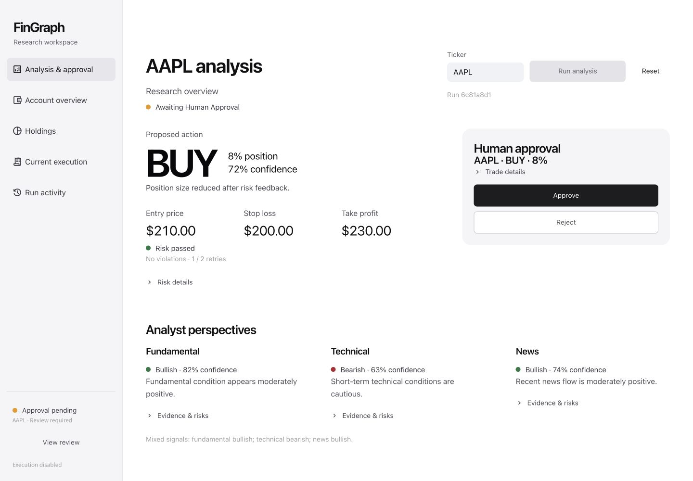

# FinGraph

FinGraph is a Python research workspace for understanding how several specialist
analyses can contribute to a decision. It combines structured analyst reports,
independent risk checks and an explicit human approval step in one visible
workflow. It is intended for students and beginners exploring transparent
decision systems.

The submitted version starts with **deterministic mock data and order execution
disabled**. No API keys, trading account, VS Code extension or external service is
needed for the default demonstration. Displayed prices and reports are sample
data, not current market information or financial advice.



## Requirements and installation

- CPython **3.13.x** is recommended for the locked dependency set.
- A terminal and an ordinary web browser are sufficient after installing Python.
- Run commands from the extracted project folder, where this README is.
- `requirements.txt` lists application dependencies;
  `requirements.lock.txt` records the versions for this submission.
- [TESTING.md](TESTING.md) records the actual validation environment, results and
  bundled offline dependency instructions. Instructions for an operating system
  are not a claim that that operating system was tested.

Online installation requires access to Python's package repository. The supplied
wheel bundle, on its documented compatible platform, avoids that download.
Wheels for one operating system, architecture or Python version need not work on
another. Follow the bundle's compatibility notes in `TESTING.md`.

### macOS or Linux terminal

Install CPython 3.13 if `python3.13` is unavailable, then run:

```bash
python3.13 --version
python3.13 -m venv .venv
.venv/bin/python -m pip install -r requirements.lock.txt
.venv/bin/python -m streamlit run app/streamlit_app.py
```

Open the local address printed by Streamlit, normally `http://localhost:8501`.
Leave the terminal running. Use Ctrl+C in that terminal to stop the app.

For the tests or optional command-line demonstration, open another terminal in
the same project folder:

```bash
.venv/bin/python -m pytest -q
.venv/bin/python main.py
```

### Windows PowerShell

Install CPython 3.13 with the Python launcher, then run:

```powershell
py -3.13 --version
py -3.13 -m venv .venv
.\.venv\Scripts\python.exe -m pip install -r requirements.lock.txt
.\.venv\Scripts\python.exe -m streamlit run app/streamlit_app.py
```

Open the local address printed by Streamlit. Use Ctrl+C to stop it. In another
PowerShell window in the project folder:

```powershell
.\.venv\Scripts\python.exe -m pytest -q
.\.venv\Scripts\python.exe main.py
```

These commands call the virtual environment's interpreter directly, so activating
it or changing PowerShell's execution policy is unnecessary.

## Default demonstration

Do not create a `.env` file for this demonstration. Keep every `USE_REAL_*`
setting and `USE_PAPER_TRADING` false, including inherited terminal environment
values. Settings are in `config/settings.py`. A fresh extraction has no
credentials and uses mock providers. The test configuration also disables
external integrations.

The mock decision deliberately proposes an oversized position first. The risk
engine rejects it, the decision model revises it, and the accepted proposal pauses
for human review. This exposes the feedback step without external services.

| Check | Action | Expected result in default mode |
| --- | --- | --- |
| Initial screen | Start the dashboard without pressing Run analysis. | Idle workspace; no analysis starts. |
| Normal run | Enter `AAPL`, select **Run analysis**, and open **Risk details**. | Mock reports, risk feedback and a proposal awaiting human approval. |
| Blank input | Select **Reset**, clear the ticker, then select **Run analysis**. | A readable validation error; no graph starts. Enter `AAPL` to continue. |
| Reject | Run the normal example, then select **Reject**. | Rejection is recorded; no order is submitted. |
| Approve with execution disabled | Reset, run again, then select **Approve**. | The paused run resumes and completes. Execution is skipped; **Current execution** shows no execution. |
| Navigation | Switch among views while approval is pending. | The same reports, run and approval state remain; navigation does not start another analysis. |

The optional command-line example asks `Approve trade? [y/n]:`. Enter `n` to
reject or `y` to approve the local workflow. Default approval still skips order
execution. It does not enable trading.

## The five dashboard views

| View | Purpose |
| --- | --- |
| Analysis & approval | Ticker controls, proposal, risk, analyst summaries, evidence, disagreements and the human decision. |
| Account overview | Current portfolio totals, operating modes and current review status. |
| Holdings | Current quantities, market values and portfolio weights. |
| Current execution | The current run's result, or an explicit no-execution state, and the returned portfolio. |
| Run activity | Run metadata, event log and the redacted state view. |

The interface displays current-run information. It does not provide historical
performance, profit predictions, a watchlist or live-trading controls.

## Architecture

```text
Start -> data and portfolio -> three specialist analyst branches
      -> Decision Agent -> deterministic Risk Engine
          -> retry Decision Agent while rejected proposals have retries left
          -> end when risk retries are exhausted
          -> finish HOLD without a trading approval
          -> pause eligible BUY/SELL for a human decision
                -> reject: end
                -> approve: execution step -> portfolio refresh -> end
```

`graph/builder.py::build_graph` defines the workflow. A fan-in edge waits for all
three reports. Risk rules remain ordinary Python logic outside the model.
`Command(resume=...)` resumes the existing checkpoint thread; it does not restart
the analysts. With paper trading disabled, the execution node skips submission.
Portfolio refresh is followed by **END**, not an automatic new decision or a
continuously trading loop.

Checkpoints and session state are in memory. They support a paused run within the
running app; restarting the app is not persistent run-history storage.

## Source map and programming concepts

| Location | Responsibility |
| --- | --- |
| `main.py` | Interactive command-line demonstration. |
| `app/` | Streamlit presentation, session handling and pure view transformations. |
| `graph/` | Typed state, graph construction and conditional routing. |
| `nodes/` | Data, analysis, decision, risk, approval and execution steps. |
| `schemas/` | Validated report, proposal, risk, execution and portfolio objects. |
| `services/`, `data/`, `execution/` | Mock implementations and optional integration boundaries. |
| `config/` | Configuration defaults. |
| `tests/` | Logic, service-boundary and dashboard-interaction tests. |

Two concrete concepts to explain are **classes**
(`app/dashboard_runner.py::DashboardRunner`) and **recursion**
(`app/dashboard_view.py::_serialize`). The class owns one resumable run; the
recursive function walks nested models, dictionaries, lists and tuples for the
debug view. Tests provide evidence for their behavior. The official course topic
list determines advanced-concept credit; installing a library alone is not the
explanation.

See [Project notes](docs/PROJECT_NOTES.md) for code mappings and assistance,
[Padlet material](docs/PADLET.md) for the short description, and
[Demo outline](docs/DEMO.md) for the timed presentation.

## Optional integrations

The source retains optional market, fundamentals, news, LLM and Alpaca Paper
adapters. `.env.example` describes settings and contains no real credentials.
These integrations are unnecessary for the default demonstration. Do not upload
an actual `.env`, keys or account data. The broker adapter supports the Alpaca
paper endpoint only. An accepted paper order is not a confirmed fill.

This educational research prototype makes no profitability claim and does not
provide financial advice.
